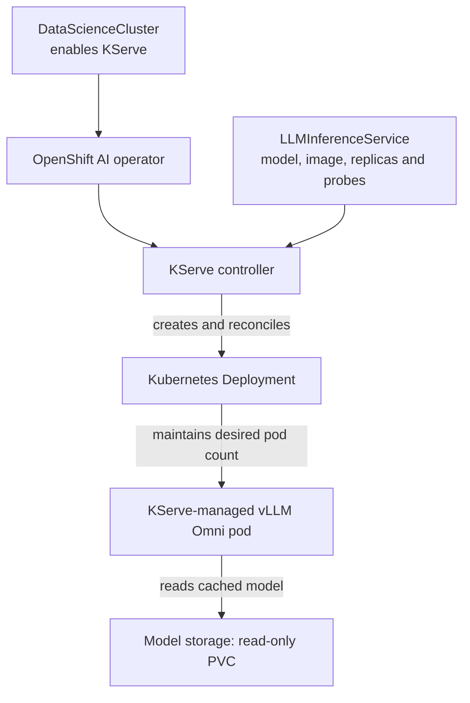
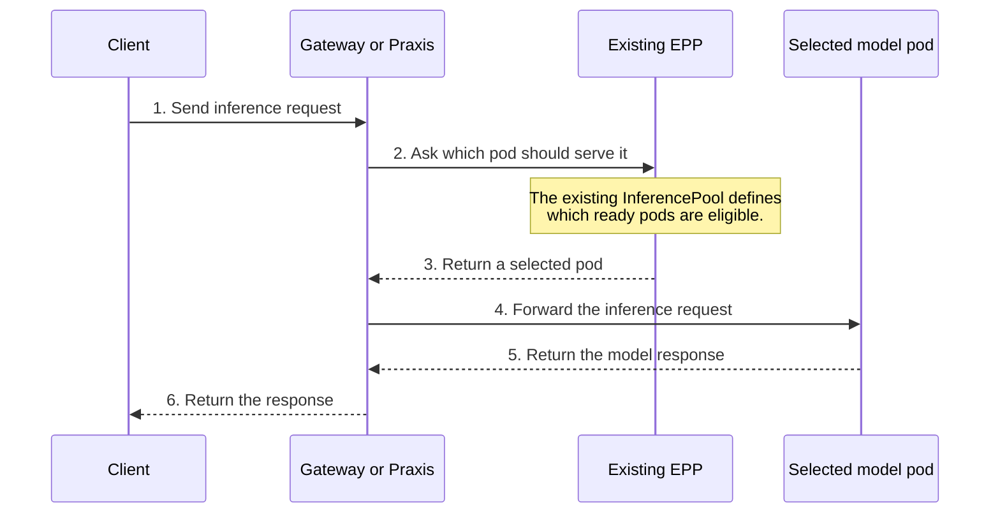

# KServe on Wetlab: handover and recreation guide

> Historical 12 November snapshot. Cluster identifiers have been replaced with
> examples for this public repository; this is not a live cluster export. The
> later [MaaS-managed path](maas-kserve-multimodal.md) is a separate setup.

Recorded 12 November 2026. Read this guide from the repository root. It
describes **Red Hat OpenShift AI-managed KServe 3.5.2**, not the standalone
upstream KServe installation used in our Kind lab. Check the live state before
acting: versions, quota, node caches and the existing stack can change.

## What is working

One `LLMInferenceService`, `model-serving/kserve-bm003-node42-managed`, manages
one live `bm-003` vLLM Omni replica. Its pod matches the existing
`endpoint-picker` InferencePool selector and is eligible for the existing EPP.
The two older model replicas still use ordinary Deployments. KServe has **not**
taken over those replicas, the Gateway, Praxis, the existing EPP or the pool.

We tested two paths separately, using small in-cluster audio requests:

1. Existing Gateway → existing EPP → model: six requests succeeded; three
   reached the KServe-managed pod, according to its access log.
2. Existing Praxis → existing EPP → model: six requests succeeded; the EPP
   logged their request IDs and the KServe pod logged three successful ones.

This demonstrates a working **single-replica integration for those requests**.
It is not a proof of all modalities, streaming, external client access,
authentication, authorization, model entitlements, metering, automatic
scaling, failover under load, or production support for this custom runtime.
The operator reported `KserveLLMInferenceServiceDependencies=False`, naming
missing Red Hat Connectivity Link and cert-manager; a successful narrow test
does not waive platform prerequisites or establish product support.

The namespace GPU quota was **3/3 in use** immediately after deployment.
Verify it again before starting more workloads. The replica is live and can
receive real traffic.

## Architecture and responsibilities

There are two parts to understand: **KServe creates and maintains the model
workload**, while the existing Gateway, Praxis and EPP handle requests.

### 1. How the model pod is managed



The `LLMInferenceService` is our desired configuration; the KServe controller
reconciles it. Kubernetes runs the pod and its health checks. The pod reads the
model from the existing PVC. KServe also creates a workload Service, omitted
from this diagram for clarity.

### 2. How a request reaches a model

We tested **two separate entry paths**: one request entered through the Istio
Gateway and another entered through Praxis. In the diagram below, “Gateway
or Praxis” means whichever one received that request; it does not imply that
the Gateway passes the request to Praxis.



At the time of the test, the pool's label selector matched **three ready model
pods**: one managed by KServe and two managed by the original Deployments. The selected
pod can be any eligible one. The InferencePool is configuration used for
selection; it is not a network hop that forwards the request. KServe is not
in the per-request path. The diagram shows successful EPP selection; the
existing pool is configured `FailOpen` if the EPP cannot be used.

The `LLMInferenceService` tells KServe the model, runtime, pod labels,
resources, PVC, probes and desired count. KServe reconciles a Deployment and a
Service and reports conditions. Kubernetes schedules pods, evaluates probes,
restarts failed containers and replaces pods to satisfy the Deployment. Startup
allows time for model initialization; readiness controls eligibility; liveness
can trigger a restart. KServe's Ready condition is useful but does not prove an
end-to-end request works. In particular, the separate zero-replica test was
Ready even though it served no traffic.

The existing pool selects matching pods on port 8000. Its EPP reference is
`endpoint-picker-epp:9002`, with `failureMode: FailOpen`. Its active `tts.yaml`
profile uses `active-request-scorer` and `max-score-picker`; it is not evidence
of cache-aware routing or a controlled load-balancing benchmark. The EPP logged
that token estimation is unsupported for the tested audio body, although the
requests succeeded. The model container serves HTTP; our current test resource
sets `security.opendatahub.io/enable-auth: "false"`. Do not infer end-to-end
TLS or authentication from these results; the platform and Praxis owners must
confirm the intended security design before broader exposure.

## Recorded versions and integration contract

| Item | Observed on Wetlab |
| --- | --- |
| OpenShift Container Platform | 4.22.5 |
| OpenShift AI Operator | CSV `rhods-operator.3.5.2`, `stable-3.x`; installed in `redhat-ods-operator` |
| Subscription source | `redhat-operators` in `openshift-marketplace`; automatic approval; current CSV 3.5.2. A channel is not a version pin. |
| KServe control | `DataScienceCluster/default-dsc`, `spec.components.kserve.managementState: Managed` |
| Controller preset | `redhat-ods-applications/v3-5-2-kserve-config-llm-template` |
| KServe API | `serving.kserve.io/v1alpha2`, `LLMInferenceService` |
| Namespace and workload | `model-serving`, `kserve-bm003-node42-managed`, one replica |
| Model image | `docker.io/vllm/vllm-omni@sha256:6b44ee504a0dc3a21eacf72e7dc5da318b7bcc8ed0e349dc928e67278414430c`, pull policy `Never` |
| Model storage | PVC `model-cache-node-42`; subdirectory `approved/bm-003/0c0e3051f131929182e2c023b9537f8b1c68adfe`; mounted read-only on node `example-gpu-node-42` |
| Model / resources | Served name `bm-003`, port 8000, 1 GPU, 2 CPU / 8 GiB requested, 8 CPU / 16 GiB limits |
| Pool | `inference.networking.k8s.io/v1` `InferencePool/endpoint-picker`; label `llm-d.ai/pool=qwen3-tts`; target port 8000 |
| EPP | `endpoint-picker-epp`; running image digest `sha256:1be86297f2af55149f5c117d11f37ff6b0d85f983069ae93e064314560d25d00`; deployment references mutable tag `new-approach` |
| Gateway | `inference-gateway`, class `data-science-gateway-class`, HTTP listener port 80; HTTPRoute `endpoint-picker` targets the pool |
| Praxis | `praxis-ai-llmd:8080`; configured separately by its owner |

The external OpenShift Route `demo-inference-gateway` targets the Gateway
Service with edge TLS termination. Our recorded request tests were internal;
they did not establish the external route's end-to-end security or Praxis
authentication. The HTTPRoute has exact matches for `/v1/audio/speech`,
`/v1/audio/transcriptions` and `/v1/chat/completions`.

The existing EPP talks plaintext (`--secure-serving=false`); the existing
Istio DestinationRule `endpoint-picker-epp-plaintext` sets TLS `DISABLE` for
its Service host. A previous resource that referenced the shared router and
pool caused KServe to create conflicting TLS rules and Gateway HTTP 500s. It
was rolled back with approval. **Do not apply**
the earlier `kserve-bm003-node42` incident configuration, even at zero replicas.
The successful resource omits `spec.router` entirely. An empty router object
is a different configuration and should not be assumed equivalent.

## What is saved, and what is still needed on another cluster

| Item | Source or owner |
| --- | --- |
| Sanitized historical LLMInferenceService | [`bm003-wetlab-node42.yaml`](../../manifests/kserve/bm003-wetlab-node42.yaml); starts one replica if applied after adaptation |
| Adaptable, zero-replica workload | [`llminferenceservice-template.yaml`](../../manifests/kserve/llminferenceservice-template.yaml); replace all placeholders and review before use |
| Wetlab's initial KServe DSC intent | [`datasciencecluster-example.yaml`](../../manifests/kserve/datasciencecluster-example.yaml); cluster-scoped **review material**, not an apply-ready universal installer |
| Integration test and incident summary | The validation and incident notes in this document |
| Operator/catalog, platform prerequisites | Cluster/platform administrator; version and available catalog must be verified |
| Gateway, HTTPRoute, Praxis, EPP, pool, routing policies, auth and metrics | Existing platform owners; obtain their source manifests, versions, image digests and deployment instructions. Selected non-secret observations are in [kserve-routing-reference.md](kserve-routing-reference.md). |
| GPU driver/operator, node labels, quotas, PVC/storage and model contents | Cluster/storage administrators; adapt the existing [model-cache manifests](../../manifests/model-cache/README.md) and provide approved cached data |
| Credentials and certificates | Platform's approved secret-management process; never put values in this repository |

**The repository does not contain a complete, tested installer for the
existing Gateway/Praxis/EPP platform, operator catalog, GPU drivers, storage,
or model data.** This repository's node-local storage manifests describe the
current lab and require review and adaptation for different hardware.
Ask each owner for its source repository and exact versions. Without those
artifacts and an independently tested target cluster, copying this repository
alone cannot reproduce the whole Wetlab system. The steps below recreate our
KServe workload **on an equivalent existing platform**.

## Tutorial: recreate the KServe integration

### 1. Prepare the target cluster

Work with the platform administrator. Provide the desired OpenShift/OpenShift
AI version, namespace, GPU capacity, storage, approved security posture, and
existing platform repositories. This guide does not authorize downloading
images, model weights, or software. The administrator must pre-provision the
approved operator/catalog artifacts, model image, and model data through their
approved process. `imagePullPolicy: Never` needs the specified image cached on
the actual chosen node; a PVC declaration alone does not create its contents.
Review OpenShift AI's [disconnected installation guide](https://docs.redhat.com/en/documentation/red_hat_openshift_ai_self-managed/3.5/html/installing_and_uninstalling_openshift_ai_self-managed_in_a_disconnected_environment/deploying-openshift-ai-in-a-disconnected-environment_install).

Check access and record the target before making changes:

```sh
oc whoami
oc config current-context
oc get clusterversion version
oc get subscription,csv -n redhat-ods-operator
oc get datasciencecluster
oc get crd llminferenceservices.serving.kserve.io
```

The operator installation and DSC are cluster-scoped and require appropriate
administrator access. Namespace deployment normally needs create/update access
to `LLMInferenceService` and related resources. Avoid storing kubeconfig,
tokens, certificates or `Secret` values in Git.

### 2. Install or enable the OpenShift AI KServe component

If the operator is absent, the administrator installs the approved **Red Hat
OpenShift AI Operator**, not upstream KServe. Follow the [OpenShift AI 3.5
installation instructions](https://docs.redhat.com/en/documentation/red_hat_openshift_ai_self-managed/3.5/html/installing_and_uninstalling_openshift_ai_self-managed/installing-and-deploying-openshift-ai_install).
Wetlab uses channel `stable-3.x` with automatic updates; that channel does not
pin version 3.5.2. The administrator must select an available approved CSV,
catalog snapshot, upgrade policy and disconnected artifact supply. Do not
assume 3.5.2 remains available or that its defaults apply to 3.7.

Inspect all existing DataScienceClusters first. If one exists, the administrator
reviews it and changes only the intended KServe configuration using the
supported procedure, preserving other components. If none exists, review the
saved DSC example and server-side defaulted fields before the administrator
creates an appropriate DSC for the target. `managementState: Removed` can cause
an installed component to be removed; an omitted field can acquire defaults.
Do not apply the Wetlab DSC example blindly to a shared cluster or change
cluster-wide KServe TLS just to match this tutorial.

Example read-only checks after installation:

```sh
oc get datasciencecluster default-dsc -o json | jq '.spec.components.kserve, .status.phase, [.status.conditions[] | select(.type | startswith("Kserve")) | {type,status,reason,message}]'
oc get deployment -n redhat-ods-applications | grep -i kserve
oc get crd llminferenceservices.serving.kserve.io
```

Use the actual DSC and applications namespace if different. Investigate false
conditions and required dependencies with the administrator and Red Hat;
overall DSC Ready alone does not establish every feature is available.

### 3. Check the existing inference platform

Set values for the target cluster. These commands read resources and do not
install or modify the routing stack:

```sh
TARGET_NS="model-serving"
POOL_NAME="endpoint-picker"
EPP_DEPLOYMENT="endpoint-picker-epp"
oc -n "$TARGET_NS" get resourcequota,limitrange
oc -n "$TARGET_NS" get inferencepool "$POOL_NAME" -o yaml
oc -n "$TARGET_NS" get deployment "$EPP_DEPLOYMENT" -o yaml
oc -n "$TARGET_NS" get gateway,httproute
oc -n "$TARGET_NS" get destinationrule
oc -n "$TARGET_NS" get pvc
```

Record the pool's exact selector, target port, model identity and EPP service;
confirm the model pod and pool use the same port and protocol. Check the
model's runtime, replicas, EPP compatibility, existing route and policy with
their owners. In Wetlab the selector is `llm-d.ai/pool=qwen3-tts`, and a pod
with that label can receive live traffic as soon as it becomes ready. Do not
reconfigure an existing shared pool, EPP or Gateway as part of this tutorial.

Ensure the namespace has quota for the new pod's GPU, CPU, memory, pod count,
and Service; the target node has the GPU, cached image and compatible runtime;
the bound PVC's selected subdirectory contains the approved model; and the
model server can read it under OpenShift security constraints. Node-local PVCs
and GPU placement do not automatically move to a replacement node or cluster.
This guide cannot establish free GPU capacity or cache contents remotely;
verify with the cluster/storage owner.

### 4. Prepare the workload at zero replicas

Copy [`llminferenceservice-template.yaml`](../../manifests/kserve/llminferenceservice-template.yaml)
to a target-specific file and replace **every** `<...>` placeholder, including
the namespace, PVC and subdirectory in both `uri` and `subPath`, node, image
digest, model name and pool selector value. The example selector assumes the
pool uses the `llm-d.ai/pool` key; adapt the label key and value to the actual
pool. Keep `spec.router` absent for this design. Set the intended **final**
labels before creating the resource: on Wetlab KServe included these labels
in the generated Deployment's immutable selector. Changing them later can
fail and may require a replacement Deployment and approval to remove resources.

Review `enable-auth`, model HTTP, pod security, probes, resource limits and the
exposure policy with the relevant owners. The sample deliberately mirrors the
current test and is not a production security configuration. Use a unique
resource name and confirm that no resource already uses it. For the following
example, `TARGET_FILE` is your edited file:

```sh
TARGET_NS="model-serving"
TARGET_FILE="deploy/manifests/kserve/my-target-llmisvc.yaml"
oc -n "$TARGET_NS" create --dry-run=server --validate=strict -f "$TARGET_FILE" -o yaml
```

Inspect the admission result: correct name/namespace, `replicas: 0`, no
`router`, correct final labels, PVC, node, image digest, `Never`, offline
settings and HTTP probes. Dry run does **not** execute the KServe controller.
After review, create the new resource:

```sh
oc -n "$TARGET_NS" create -f "$TARGET_FILE"
```

Check what the installed controller actually creates before starting a pod:

```sh
MODEL_SERVICE="replace-with-your-service-name"
oc -n "$TARGET_NS" get llminferenceservice "$MODEL_SERVICE" -o yaml
oc -n "$TARGET_NS" get deployment,service,destinationrule,httproute,inferencepool
oc -n "$TARGET_NS" get pods -l "app=$MODEL_SERVICE"
```

Compare resources and DestinationRules with the pre-change state. Inspect the
generated Deployment's pod template, including **all containers and init
containers**, image pull policies, node selector, probes, PVC and labels. An
operator preset can add configuration not visible in the submitted YAML. Zero
replicas avoids starting a model but does not guarantee no networking resources
are created; stop and investigate unexpected shared changes. `Ready=True` at
zero replicas is not evidence that the model works.

### 5. Start and verify one replica

After the cached data, image, security and live traffic implications have been
checked, update your source file to `replicas: 1` and apply the reviewed change.
For a resource already created from the template, the equivalent scoped
command is:

```sh
oc -n "$TARGET_NS" patch llminferenceservice "$MODEL_SERVICE" --type=merge -p '{"spec":{"replicas":1}}'
oc -n "$TARGET_NS" get llminferenceservice "$MODEL_SERVICE" -w
```

Stop the watch with Ctrl-C. The matching pool can send traffic to this pod once
it is ready. Check ownership, startup, probe success and pool membership:

```sh
oc -n "$TARGET_NS" get deployment,pod -l "app=$MODEL_SERVICE" -o wide
oc -n "$TARGET_NS" get llminferenceservice "$MODEL_SERVICE" -o json | jq '.status.conditions, .status.appliedConfigs'
oc -n "$TARGET_NS" logs "deployment/${MODEL_SERVICE}-kserve" -c main --tail=50
oc -n "$TARGET_NS" get pods -l 'llm-d.ai/pool=qwen3-tts' -o wide
oc -n "$TARGET_NS" get resourcequota
```

Replace the selector in the fourth command with the target pool's actual
selector. Generated deployment naming can vary by release; inspect the owned
Deployment if `${MODEL_SERVICE}-kserve` is not present. Check the logs for
`ErrImageNeverPull`, PVC mount failures, GPU scheduling and model startup
errors; do not enable pulls or download weights as a workaround without
administrator authorization. Review actual effective probes and image policies
on the generated Deployment. Watch `oc get destinationrule` for unwanted
changes to shared hosts.

### 6. Prove request routing

Adapt the following Wetlab examples to an approved model, endpoint and client.
They run small requests inside the cluster and discard the generated audio.
The first command uses the Praxis **pod only as a client** to call the Gateway;
it does not test the Praxis process. The second calls the actual Praxis
listener. Both request paths were tested independently on Wetlab.

```sh
oc -n model-serving exec deployment/praxis-ai-llmd -- wget -q -S -T 60 --header 'Content-Type: application/json' --post-data '{"model":"bm-003","input":"Hi.","voice":"Vivian","response_format":"wav"}' -O /dev/null 'http://inference-gateway-data-science-gateway-class.model-serving.svc.cluster.local/v1/audio/speech?kserve_handover=gateway-01'
oc -n model-serving exec deployment/praxis-ai-llmd -- wget -q -S -T 60 --header 'Content-Type: application/json' --header 'x-request-id: kserve-handover-praxis-01' --post-data '{"model":"bm-003","input":"Hi.","voice":"Vivian","response_format":"wav"}' -O /dev/null 'http://127.0.0.1:8080/v1/audio/speech?kserve_handover=praxis-01'
```

A successful response alone could come from another replica. Check the
uniquely marked paths in the KServe pod's access logs and the Praxis request ID
in EPP logs. Because selection is shared, a particular request need not go to
the new replica; repeat a small number of uniquely marked requests if needed.

```sh
oc -n model-serving logs deployment/kserve-bm003-node42-managed-kserve -c main --since=10m | grep 'kserve_handover'
oc -n model-serving logs deployment/endpoint-picker-epp --since=10m | grep 'kserve-handover-praxis-01'
```

On another cluster substitute the actual Deployment, pool, service and model
names. These checks do not establish performance, streaming, external access,
authentication, token metrics or resilience; agree separate acceptance tests
with the owners. For this audio body Wetlab's EPP skipped token estimation.

### 7. Operations, changes and recovery

Keep the reviewed target-specific manifest, this guide and the external
owners' source references in the team's source control. Keep a copy outside
the cluster; don't rely on a local-only workspace or generated resources.
Protect credentials separately. Record approved operator catalog/CSV, image
digests, target node/storage mapping, model revision, security settings and
the independent stack's versions. Re-run this tutorial on another suitable
cluster before describing it as a tested disaster-recovery procedure.

If a model pod is unready, inspect the LLMInferenceService conditions, owned
Deployment, pod events, container logs, probes, PVC and GPU quota. KServe
manages desired configuration; Kubernetes acts on health checks. Do not
manually change KServe-owned child objects and expect the change to persist.
At zero replicas, Ready does not mean model serving is functional.

Scaling to zero terminates the model pod and releases its GPU, while removing
an LLMInferenceService may also remove resources it owns. Either can affect
traffic and can delete Kubernetes resources. Follow the user's and platform's
approval requirements before doing so; preserve the manifest and cached model.
Replacing either original replica is a separate, coordinated migration and has
not yet happened. There is currently no validated full-cluster restoration or
automatic failover across the node-specific caches.

## References

- [KServe LLMInferenceService architecture](https://kserve.github.io/website/docs/concepts/architecture/control-plane-llmisvc) and [configuration composition](https://kserve.github.io/website/docs/model-serving/generative-inference/llmisvc/llmisvc-config-composition). These are upstream docs; check version differences against the installed Red Hat build.
- [Red Hat OpenShift AI 3.5 installation and component management](https://docs.redhat.com/en/documentation/red_hat_openshift_ai_self-managed/3.5/html/installing_and_uninstalling_openshift_ai_self-managed/installing-and-deploying-openshift-ai_install).
- [Red Hat OpenShift AI 3.5 distributed inference and EPP routing](https://docs.redhat.com/en/documentation/red_hat_openshift_ai_self-managed/3.5/html/deploy_models_using_distributed_inference_with_llm-d/configuring-llm-scheduler).
- [Red Hat 3.5 known issues](https://docs.redhat.com/en/documentation/red_hat_openshift_ai_self-managed/3.5/html/release_notes/known-issues_relnotes), including INFERENG-6962 on EPP bypass in a specific shared wildcard-listener topology. Applicability to Wetlab's custom Praxis path has not been established.
- [Gateway API Inference Extension](https://gateway-api-inference-extension.sigs.k8s.io/) for InferencePool and endpoint selection concepts.
