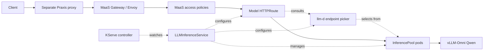

# Redeploy the Wetlab Praxis, MaaS and KServe proof of concept

This guide records the setup tested on OpenShift AI **3.5.3–3.5.4**. It has
not been rebuilt on a second cluster and is not a validated 3.7 or production
deployment. Confirm the target release and intended Praxis/MaaS architecture
with the platform owners. Commands and files below require adaptation.

Cluster hostnames, IP addresses, users and namespaces have been replaced with
examples for this public repository. In particular, `192.0.2.0/24` is a
documentation-only address range; substitute the destination API addresses.
These values describe the configuration shape, not the original cluster.

## Architecture



The response returns through the Gateway and Praxis. KServe manages resources
in the background; it is not a request hop. The Gateway consults the EPP to
select a pod in the pool. The earlier [router-free setup](kserve-llmd.md) used
a separately managed pool and EPP; this MaaS test used its own KServe-managed
route, pool and EPP. The Praxis proxy here forwards to MaaS and is not a
demonstration of the proposed standalone Praxis/EPP architecture for 3.7.

The [test record](../validation/maas-kserve-multimodal-2026-11.md) documents
what was actually tested, including the multipart ASR failure and unfinished
two-replica TTS routing. The old investigation chronology and original files
remain [available in Git history](https://github.com/PoolPooer/wetlab-operations/tree/6146d2f/manifests/maas/wetlab-3.5).

## Prerequisites

- Coordinate the OpenShift AI version, Gateway ownership, supported MaaS/Praxis
  integration, quotas, DNS and ingress with the cluster owner. Wetlab used
  **OpenShift AI-managed KServe**, not a separate upstream installation.
- Confirm GPUs, node memory, storage, RBAC, network policies, certificates and
  approved image registry access. Install or enable supported KServe, Gateway
  and MaaS prerequisites for the chosen release. The earlier
  [KServe enablement reference](../../manifests/kserve/README.md) includes a
  DataScienceCluster example for platform-owner review.
- Make the approved vLLM-Omni image and model weights available using the
  [model-cache workflow](../../manifests/model-cache/README.md). Model examples
  use cached images, `imagePullPolicy: Never` and offline model settings; a
  different cluster must have its own approved image and weight copies.
- Provide a persistent PostgreSQL service and MaaS connection Secret as
  required by the chosen release. For a restored database, restore its original
  credentials and data; do not generate a replacement password. Decide whether
  to migrate API keys or issue new ones. Keep secrets out of Git.
- Adapt all namespaces, Gateway hostnames, certificates, node names, PVCs,
  paths, API IP addresses, image digests, pull secrets, users and resource
  limits. The supplied network policies and identities are Wetlab-specific.

The files are under `deploy/manifests/maas/wetlab-3.5/`. The examples below assume a
shell started at the repository root, and use `create` to avoid silently
overwriting existing resources. Review differences and ownership first.
Operator reconciliation can pull multiple images and affect shared Gateways.

## 1. Platform and database

Inspect existing subscriptions, OperatorGroups, Kuadrant instances and the
OpenShift AI `DataScienceCluster` before installing duplicates. For the 3.5
Wetlab reference, the following files describe RHCL and cert-manager. The
subscriptions use manual InstallPlan approval; inspect the resolved plans and
their dependencies before approving them and monitor downloads and restarts.

```sh
oc get subscription,operatorgroup -A
oc get kuadrant -A
oc get datasciencecluster
oc create -f deploy/manifests/maas/wetlab-3.5/platform/cert-manager-namespace.yaml
oc create -f deploy/manifests/maas/wetlab-3.5/platform/cert-manager-subscription.yaml
oc create -f deploy/manifests/maas/wetlab-3.5/platform/rhcl-subscription.yaml
oc get installplan,csv -A
```

After the appropriate operators are installed, the Kuadrant reference creates
Authorino and Limitador. Wetlab enabled Authorino TLS by annotating the
operator-created service, then applying the reviewed TLS patch. The patch and
environment change can replace Authorino pods. Verify the service CA ConfigMap
and reconcile behavior for the target version before applying the commands.

```sh
oc create -f deploy/manifests/maas/wetlab-3.5/platform/kuadrant.yaml
oc get kuadrant,pods -n kuadrant-system
oc annotate service authorino-authorino-authorization -n kuadrant-system service.beta.openshift.io/serving-cert-secret-name=authorino-server-cert --overwrite
oc get secret authorino-server-cert -n kuadrant-system -o name
oc get configmap openshift-service-ca.crt -n kuadrant-system
oc patch authorino authorino -n kuadrant-system --type=merge --patch-file deploy/manifests/maas/wetlab-3.5/platform/authorino-tls-patch.yaml
oc -n kuadrant-system set env deployment/authorino SSL_CERT_FILE=/etc/ssl/certs/openshift-service-ca/service-ca-bundle.crt REQUESTS_CA_BUNDLE=/etc/ssl/certs/openshift-service-ca/service-ca-bundle.crt
```

Use the approved PostgreSQL service, or review the
[optional Wetlab database example](../../manifests/maas/wetlab-3.5/optional-postgres/README.md).
The example is node-local with no backup or HA; adapt or replace its storage,
identity, TLS and recovery before using it on another cluster.

## 2. Enable the Gateway and MaaS

The example Gateway is **internal only**, pinned to a Wetlab node and uses the
cluster ingress certificate. Adapt it and check its name is unused. Review
`DataScienceCluster` before applying these cluster-wide patches; wait for AI
Gateway readiness and database connectivity before enabling MaaS.

```sh
oc create --dry-run=server -f deploy/manifests/maas/wetlab-3.5/platform/gateway.yaml
oc create -f deploy/manifests/maas/wetlab-3.5/platform/gateway.yaml
oc patch datasciencecluster default-dsc --type=merge --patch-file deploy/manifests/maas/wetlab-3.5/platform/enable-ai-gateway.yaml
oc get datasciencecluster default-dsc -o yaml
# Wait for AIGatewayReady=True, the database and Gateway before continuing.
oc patch datasciencecluster default-dsc --type=merge --patch-file deploy/manifests/maas/wetlab-3.5/platform/enable-maas.yaml
oc get gateway maas-default-gateway -n openshift-ingress
oc get datasciencecluster default-dsc -o yaml
```

Check `ModelsAsAServiceReady`, MaaS API/controller pods, policies, certificates
and database connectivity. On Wetlab shared Gateway pods restarted after RHCL
reconciliation; the cause was not established. Watch existing routes as well.

## 3. KServe model and MaaS access

`models/tts.yaml` consolidates the recorded TTS configuration and patches. It
has **not** been tested as a single new-cluster manifest or compared with the
live cluster since consolidation. Inspect the reconstructed spec and perform a
server-side dry run; confirm the scheduler's effective image, generated
DestinationRules, route, pool and EPP before starting inference. Model replicas
default to zero, but the EPP is configured to start.

```sh
oc create --dry-run=server -f deploy/manifests/maas/wetlab-3.5/networking/tts.yaml
oc create --dry-run=server -f deploy/manifests/maas/wetlab-3.5/models/tts.yaml
oc create -f deploy/manifests/maas/wetlab-3.5/networking/tts.yaml
oc create -f deploy/manifests/maas/wetlab-3.5/models/tts.yaml
oc get llminferenceservice,inferencepool,httproute -n model-serving
oc get deployment,pod -n model-serving -l app.kubernetes.io/part-of=llminferenceservice
oc get destinationrule -n model-serving
```

The TTS EPP configuration uses a passthrough parser plus queue and KV-cache
scorers; it does not establish prefix-aware or load-aware behavior. Publish
the model after the route is accepted, adapting the endpoint, test user and
limits. The 10,000-token limit is a lab value, not validated audio metering.

```sh
oc create --dry-run=server -f deploy/manifests/maas/wetlab-3.5/access/tts.yaml
oc create -f deploy/manifests/maas/wetlab-3.5/access/tts.yaml
oc get maasmodelref -n model-serving
oc get maassubscription,maasauthpolicy -n models-as-a-service
```

`models/asr.yaml` defines the two ASR workloads and the KServe-managed shared
pool with separate node-local PVCs. Its selector override worked in Wetlab
3.5.4 but needs product support and version validation. It defaults model
replicas to zero while the EPP can still start. If needed, adapt and inspect
the three ASR files, then create them in this order:

```sh
oc create --dry-run=server -f deploy/manifests/maas/wetlab-3.5/networking/asr.yaml
oc create --dry-run=server -f deploy/manifests/maas/wetlab-3.5/models/asr.yaml
oc create -f deploy/manifests/maas/wetlab-3.5/networking/asr.yaml
oc create -f deploy/manifests/maas/wetlab-3.5/models/asr.yaml
oc create -f deploy/manifests/maas/wetlab-3.5/access/asr.yaml
```

Wait for the model route to be accepted and inspect the pool selector,
EndpointSlices and scheduler. Multipart ASR through MaaS remained blocked in
the recorded test.

The separate `models/tts-node32-standalone.json` was tested directly but was
**not** joined to the MaaS TTS pool. Do not treat it as a balanced setup.

## 4. Praxis and validation

The Praxis example forwards internally to MaaS. It expects the MaaS Host
header and uses an HTTP listener; public access requires a separate design.
Export the destination cluster's **public** ingress CA, adapt the manifest,
then create the ConfigMap and the Praxis resources:

```sh
python3 deploy/manifests/maas/wetlab-3.5/praxis/export-ingress-ca.py
CA_FILE=$(python3 -c 'import os, tempfile; print(os.path.join(tempfile.gettempdir(), "wetlab-praxis-maas-ingress-ca.crt"))')
oc create configmap praxis-maas-ingress-ca -n model-serving --from-file="ca-bundle.crt=$CA_FILE"
oc create -f deploy/manifests/maas/wetlab-3.5/praxis/praxis.yaml
oc get deployment,service praxis-maas -n model-serving
```

After deliberately starting the TTS model and waiting for readiness, adapt and
run the small test helper. It uses local port-forwards and creates a 15-minute
test key held in memory:

```sh
oc patch llminferenceservice kserve-maas-bm003 -n model-serving --type=merge -p '{"spec":{"replicas":1}}'
oc get pods -n model-serving -l kserve.io/component=workload
python3 deploy/manifests/maas/wetlab-3.5/tests/check-praxis-maas.py --expect-audio
```

Correlate the Gateway, EPP and selected model pod; test missing, invalid and
revoked keys and an over-quota request separately. Test multiple replicas and
load-aware behavior under controlled load. The ASR helper and
[multipart findings](../validation/asr-multipart-findings.md) reproduce the
recorded failure. Scaling a model to zero removes its pod; follow the cluster
owner's workload policy after testing. For the example TTS resource:

```sh
oc patch llminferenceservice kserve-maas-bm003 -n model-serving --type=merge -p '{"spec":{"replicas":0}}'
```

Wetlab's generated EPP/pool-shadow rules used `insecureSkipVerify: true` and
its MaaS database connection used `sslmode=require`: encryption alone did not
verify server identity. Review TLS, backups, external access and availability
before treating this as production ready.

## References

- [OpenShift AI 3.5 MaaS setup](https://docs.redhat.com/en/documentation/red_hat_openshift_ai_self-managed/3.5/html/govern_llm_access_with_models-as-a-service/deploy-and-manage-models-as-a-service)
- [OpenShift AI 3.5 llm-d scheduler configuration](https://docs.redhat.com/en/documentation/red_hat_openshift_ai_self-managed/3.5/html/deploy_models_using_distributed_inference_with_llm-d/configuring-llm-scheduler)
- [KServe LLMInferenceService configuration](https://kserve.github.io/website/docs/model-serving/generative-inference/llmisvc/llmisvc-configuration)
